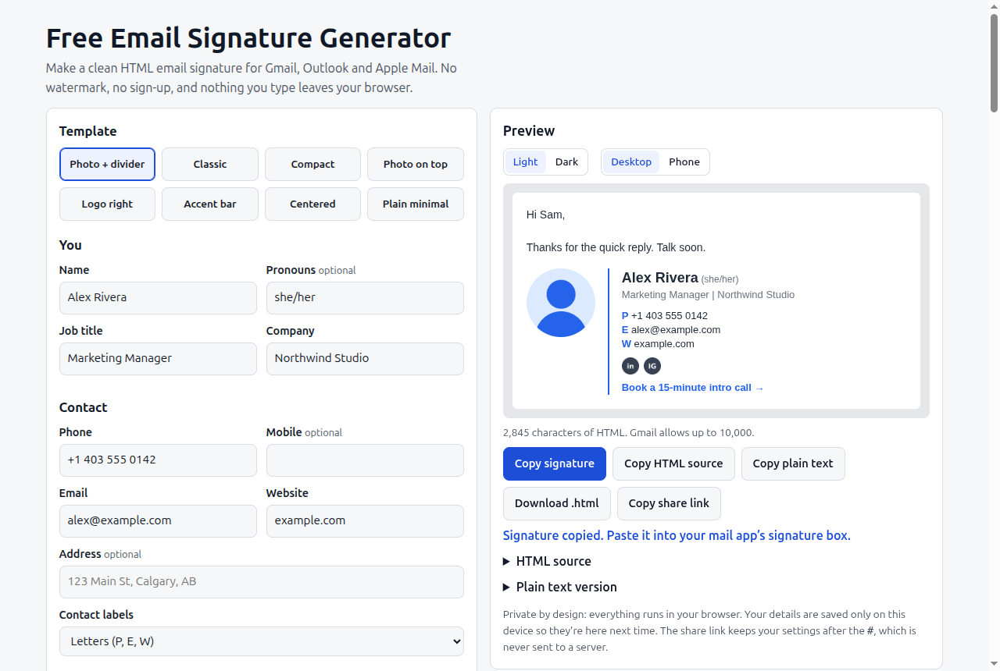

# Email Signature Generator

Free email signature generator for Gmail, Outlook and Apple Mail. No watermark, no sign-up.

**Live:** https://mizoz.github.io/email-signature/



I built this because every "free" signature generator I tried wanted my email first, then slipped its own link into my signature, then put the nice templates behind a trial. This one just makes the HTML and gets out of the way.

## What it does

- 8 templates: photo + divider, classic, compact, photo on top, logo right, accent bar, centered, and a plain one with no images
- Name, pronouns, title, company, phone, mobile, email, website, address
- Photo and logo by https link (on purpose, see below)
- LinkedIn, X, Instagram, Facebook, YouTube, TikTok and GitHub as small icons or text links
- Call to action line and a legal disclaimer
- Accent and text colour, email-safe fonts only
- **Copy signature** puts formatted HTML on your clipboard so it pastes properly into Gmail, Outlook and Apple Mail
- Copy the HTML source, copy a plain text version, or download an .html file
- Light/dark and desktop/phone preview
- Shows your character count against Gmail's 10,000 limit
- Remembers your details in your browser, and a share link puts your settings in the URL hash
- Install steps for Gmail, new Outlook, Outlook on the web, classic Outlook, Apple Mail and iPhone

## Why images have to be links

Email apps load signature images from a URL every time the email is opened. Base64 images baked into the HTML look fine in a preview and then get stripped by Gmail or turned into attachments by Outlook. So there's no upload button. Host your headshot/logo on your own site and paste the link.

The social icons are plain letter icons I made with `make_assets.py` (Pillow) and they're served from this repo's GitHub Pages, so anyone can use them. They're deliberately not the official brand logos.

## Privacy

Everything runs in your browser. Nothing is uploaded, there's no analytics, no cookies. Your details stay in localStorage on your device. The share link keeps settings after the `#`, which browsers don't send to the server.

## How it works

Plain HTML, CSS and JS, no build step. The signature is built as nested tables with inline styles, because that's still what renders the same in Outlook (Word engine), Gmail, Apple Mail and phone apps. Rich copy uses `ClipboardItem` with `text/html` and `text/plain`, and falls back to selecting the preview and `execCommand('copy')` in older browsers.

## Run locally

```
python3 -m http.server
```

Then open http://localhost:8000. To rebuild icons, demo images and og.png: `python3 make_assets.py`.

## Sources

Last checked 2026-10-21.

- Gmail signature steps and the 10,000 character limit: https://support.google.com/mail/answer/8395
- Outlook (new, web, classic) signature steps: https://support.microsoft.com/en-us/office/create-and-add-an-email-signature-in-outlook-8ee5d4f4-68fd-464a-a1c1-0e1c80bb27f2
- Apple Mail on Mac signature steps: https://support.apple.com/guide/mail/create-and-use-email-signatures-mail11943/mac
- iPhone Mail path (Settings > Apps > Mail > Signature on iOS 18 and later): https://support.apple.com/guide/iphone/

Sizes in the reference table (600 px width, photo and logo sizes, icon size, file size) are common recommendations, not official limits. The Gmail limit is the only hard number.

## License

MIT
